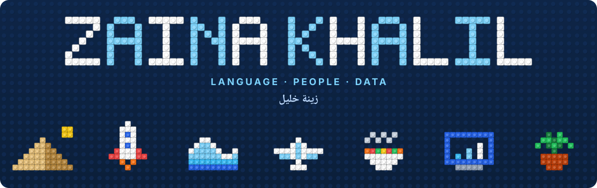

<!-- Keep header.svg and footer.svg beside this README in your profile repository. -->
<p align="center">
  
</p>

<h3 align="center">Hi &nbsp;·&nbsp; أهلاً &nbsp;·&nbsp; Hola</h3>

<p align="center">
  
</p>

<p align="center">
  <a href="https://www.linkedin.com/in/zainakhalil"></a>
  <a href="mailto:zainakhalil002@gmail.com"></a>
  <a href="https://www.instagram.com/z__eatz"></a>
</p>

<br>

As a kid in Cairo, I’d sit with my grandparents while their stories slipped between Arabic and English mid-sentence. That’s where my questions about language began: how do we move between languages, and what does that reveal about how we think?

Today, I’m studying for my **Master of Computer Science at UIUC** and exploring a new version of that question: **what happens when multilingual learners learn with AI?** My work brings together language, learning sciences, human-computer interaction, and data.

<p align="center">
  <code>🗣️ language</code> &nbsp;✕&nbsp; <code>🧠 cognition</code> &nbsp;✕&nbsp; <code>🖥️ human-computer interaction</code> &nbsp;✕&nbsp; <code>📊 data</code>
</p>

<h2>
  <picture>
    <source media="(prefers-color-scheme: dark)" srcset="https://readme-typing-svg.demolab.com?font=Inter&weight=800&size=28&duration=1&pause=100000&color=FFFFFF&vCenter=true&repeat=false&width=600&height=42&lines=Right+Now" />
    
  </picture>
</h2>

> 📚 **Researching** how Arabic-English and Spanish-English speakers learn introductory programming with AI, and how AI tutors can help learners become more independent.
>
> 🧪 **Working with PAWS Lab** at the University of Pittsburgh, evaluating Arabic translations of Python worked examples for a planned bilingual classroom study.
>
> 🎓 **Studying** for my MCS in Data Science at UIUC (4.0 GPA; expected August 2027).
>
> 💼 **Exploring** data science, analytics, and applied AI/ML opportunities.

I’m interested in AI that helps in the moment and leaves people more capable afterward. That means paying attention to what learners can still do when the tool steps away.

<h2>
  <picture>
    <source media="(prefers-color-scheme: dark)" srcset="https://readme-typing-svg.demolab.com?font=Inter&weight=800&size=28&duration=1&pause=100000&color=FFFFFF&vCenter=true&repeat=false&width=600&height=42&lines=Selected+Work" />
    
  </picture>
</h2>

| | Project | The interesting part |
|:-:|---|---|
| 🗣️ | **Bilingual Learning & AI**<br><sub>UIUC · current research direction</sub> | Studying how Arabic-English and Spanish-English speakers learn introductory programming with AI, and how tool design can support lasting independence. |
| 🔤 | **Arabic Python Example Review**<br><sub>PAWS Lab, University of Pittsburgh · 2026–present</sub> | Evaluating 123 LLM-generated translations of Python worked examples; flagged missing diacritics and right-to-left number ordering issues for regeneration. |
| 🛰️ | **SAR Image Classification**<br><sub>Ursa Space Systems · 2025</sub> | Classified vessels and icebergs in satellite radar imagery with a Keras CNN at 80%+ accuracy, then used PCA to inspect pretrained image embeddings. |
| 🚀 | **Brickonaut** 🥇<br><sub>NASA Space Apps Challenge · 2025 · Team Le’Go</sub> | Turned 608 space biology papers into three AI dashboards for scientists, mission planners, and investors, with semantic search, summaries, and a chat assistant. <br><sub>Python · Flask · Pandas · Azure OpenAI · Semantic Kernel</sub> · [Repository](https://github.com/Zona-n/NASA-SPACE-APPS) |
| 💬 | **AI Sentiment Chatbot**<br><sub>Google Sprinternship · 2025</sub> | Built a Gemini-powered Google Cloud chatbot to turn 10,000+ customer sentiment entries into useful consultant insights in a three-week sprint. |
| 🧹 | **Datatidy**<br><sub>Purdue Data Mine × Dormakaba · 2024–2025</sub> | Standardized 50,000+ international hotel access records and reduced null values by 40%, making the data more useful for downstream modeling. |
| 💧 | **Everyday 2.0** 🥇<br><sub>SparkHacks · 2025</sub> | Built a campus water-refill finder in Swift in 24 hours, using MapKit and OpenStreetMap. I liked the hackathon enough to join its organizing board the next year. |

<h2>
  <picture>
    <source media="(prefers-color-scheme: dark)" srcset="https://readme-typing-svg.demolab.com?font=Inter&weight=800&size=28&duration=1&pause=100000&color=FFFFFF&vCenter=true&repeat=false&width=600&height=42&lines=Beyond+The+Build" />
    
  </picture>
</h2>

<table>
<tr>
<td valign="top" width="50%">

**Research, teaching & speaking**

- Independent study in bilingual and multilingual cognitive processing at UIC
- Undergraduate TA for Arabic-language courses
- Student speaker and panelist, University of Illinois System Salute to Academic Achievement (2026)
- Invited panelist, UChicago Data Science Institute Summer Research Program (2026)

</td>
<td valign="top" width="50%">

**Leadership & community**

- President (and former Marketing Chair), **Impactful Relief UIC**; raised $15K+ across campaigns
- Senior Peer Mentor, **UIC Campus Housing**; supported a 300+ resident community
- **SparkHacks**: competed in 2025, helped organize 2026
- **Break Through Tech** AI/ML Fellow

</td>
</tr>
</table>

<details>
<summary><b>🏅 A few things I’m proud of</b></summary>
<br>

Summa Cum Laude · Chancellor’s Fellows Award · President’s Awards Program Scholar · Engineering Merit Scholarships · Cornell Certificate in Machine Learning Foundations · Arabic and Spanish Seals of Biliteracy · 1st place, NASA Space Apps · 1st place, UIC SparkHacks

</details>

<h2>
  <picture>
    <source media="(prefers-color-scheme: dark)" srcset="https://readme-typing-svg.demolab.com?font=Inter&weight=800&size=28&duration=1&pause=100000&color=FFFFFF&vCenter=true&repeat=false&width=600&height=42&lines=Toolbox" />
    
  </picture>
</h2>

<p>
  
  
  
  
  
  
  
</p>
<p>
  
  
  
  
  
  
  
</p>
<p>
  
  
  
  
  
  
  
  
</p>

**Spoken:** English · العربية · Español

<h2>
  <picture>
    <source media="(prefers-color-scheme: dark)" srcset="https://readme-typing-svg.demolab.com?font=Inter&weight=800&size=28&duration=1&pause=100000&color=FFFFFF&vCenter=true&repeat=false&width=600&height=42&lines=Off+The+Clock" />
    
  </picture>
</h2>

Ten years of competitive swimming taught me that most hard things get done one lap at a time. Lately, I’m seeing if the same holds on a bike. I lift, read about exercise and the brain (the cognitive science never really turns off), share what I cook and where I eat on [@Z__Eatz](https://www.instagram.com/z__eatz), and plan the next trip whenever I can.

<h2>
  <picture>
    <source media="(prefers-color-scheme: dark)" srcset="https://readme-typing-svg.demolab.com?font=Inter&weight=800&size=28&duration=1&pause=100000&color=FFFFFF&vCenter=true&repeat=false&width=600&height=42&lines=Where+I%27ve+Been" />
    
  </picture>
</h2>

<sub>🔵 home bases &nbsp;·&nbsp; 🩵 places I’ve explored</sub>

```geojson
{
  "type": "FeatureCollection",
  "features": [
    { "type": "Feature", "properties": { "name": "Cairo, Egypt", "note": "Family roots", "marker-color": "#1E40AF", "marker-symbol": "star" }, "geometry": { "type": "Point", "coordinates": [31.2357, 30.0444] } },
    { "type": "Feature", "properties": { "name": "Chicago, IL", "note": "UIC, B.S. Data Science", "marker-color": "#1E40AF", "marker-symbol": "college" }, "geometry": { "type": "Point", "coordinates": [-87.6298, 41.8781] } },
    { "type": "Feature", "properties": { "name": "Urbana-Champaign, IL", "note": "UIUC, MCS", "marker-color": "#1E40AF", "marker-symbol": "college" }, "geometry": { "type": "Point", "coordinates": [-88.2073, 40.1106] } },
    { "type": "Feature", "properties": { "name": "Sohag, Egypt", "marker-color": "#38BDF8" }, "geometry": { "type": "Point", "coordinates": [31.6948, 26.5591] } },
    { "type": "Feature", "properties": { "name": "Istanbul, Türkiye", "marker-color": "#38BDF8" }, "geometry": { "type": "Point", "coordinates": [28.9784, 41.0082] } },
    { "type": "Feature", "properties": { "name": "Tangier, Morocco", "marker-color": "#38BDF8" }, "geometry": { "type": "Point", "coordinates": [-5.8340, 35.7595] } },
    { "type": "Feature", "properties": { "name": "Chefchaouen, Morocco", "marker-color": "#38BDF8" }, "geometry": { "type": "Point", "coordinates": [-5.2636, 35.1688] } },
    { "type": "Feature", "properties": { "name": "Rabat, Morocco", "marker-color": "#38BDF8" }, "geometry": { "type": "Point", "coordinates": [-6.8498, 34.0209] } },
    { "type": "Feature", "properties": { "name": "Fes, Morocco", "marker-color": "#38BDF8" }, "geometry": { "type": "Point", "coordinates": [-5.0078, 34.0181] } },
    { "type": "Feature", "properties": { "name": "Cancún, Mexico", "marker-color": "#38BDF8" }, "geometry": { "type": "Point", "coordinates": [-86.8515, 21.1619] } },
    { "type": "Feature", "properties": { "name": "Cabo San Lucas, Mexico", "marker-color": "#38BDF8" }, "geometry": { "type": "Point", "coordinates": [-109.9167, 22.8905] } },
    { "type": "Feature", "properties": { "name": "La Paz, Mexico", "marker-color": "#38BDF8" }, "geometry": { "type": "Point", "coordinates": [-110.3128, 24.1426] } },
    { "type": "Feature", "properties": { "name": "Puerto Vallarta, Mexico", "marker-color": "#38BDF8" }, "geometry": { "type": "Point", "coordinates": [-105.2253, 20.6534] } },
    { "type": "Feature", "properties": { "name": "Dominican Republic", "marker-color": "#38BDF8" }, "geometry": { "type": "Point", "coordinates": [-69.9312, 18.4861] } },
    { "type": "Feature", "properties": { "name": "Puerto Rico", "marker-color": "#38BDF8" }, "geometry": { "type": "Point", "coordinates": [-66.1057, 18.4655] } },
    { "type": "Feature", "properties": { "name": "San Diego, CA", "marker-color": "#38BDF8" }, "geometry": { "type": "Point", "coordinates": [-117.1611, 32.7157] } },
    { "type": "Feature", "properties": { "name": "Los Angeles, CA", "marker-color": "#38BDF8" }, "geometry": { "type": "Point", "coordinates": [-118.2437, 34.0522] } },
    { "type": "Feature", "properties": { "name": "Dallas, TX", "marker-color": "#38BDF8" }, "geometry": { "type": "Point", "coordinates": [-96.7970, 32.7767] } },
    { "type": "Feature", "properties": { "name": "Ann Arbor, MI", "marker-color": "#38BDF8" }, "geometry": { "type": "Point", "coordinates": [-83.7430, 42.2808] } }
  ]
}
```

<br>

<p align="center">
  
</p>
