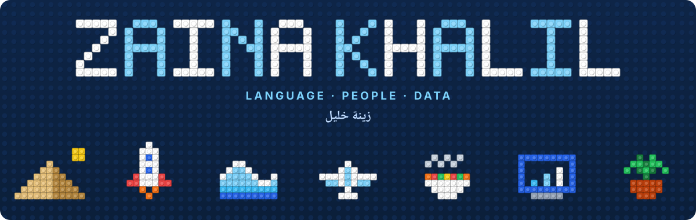

<!-- Header: upload header.svg and footer.svg to this repo next to the README -->
<p align="center">
  
</p>

<h3 align="center">Hi &nbsp;·&nbsp; أهلاً &nbsp;·&nbsp; Hola</h3>

<p align="center">
  
</p>

<p align="center">
  <a href="https://www.linkedin.com/in/zainakhalil"></a>
  <a href="mailto:zainakhalil002@gmail.com"></a>
  <a href="https://www.instagram.com/z__eatz"></a>
</p>

<br>

As a kid in Cairo, I'd sit with my grandparents while their stories slipped between Arabic and English mid-sentence. I didn't have a name for it then, but I was already wondering how people move between languages, and what that says about how we think.

I'm still wondering. Freshman year at UIC I started an independent study on how bilingual people process language, and later I TA'd Arabic courses, where I got to watch students switch between languages in real time. Now I'm working on my Master of Computer Science at UIUC, and the question has picked up a new piece: **what happens when multilingual learners start learning from AI?**

<p align="center">
  <code>🗣️ language</code> &nbsp;✕&nbsp; <code>🧠 cognition</code> &nbsp;✕&nbsp; <code>🖥️ human-computer interaction</code> &nbsp;✕&nbsp; <code>📊 data</code>
</p>

<h2>
  <picture>
    <source media="(prefers-color-scheme: dark)" srcset="https://readme-typing-svg.demolab.com?font=Inter&weight=800&size=28&duration=1&pause=100000&color=FFFFFF&vCenter=true&repeat=false&width=600&height=42&lines=Right+Now" />
    
  </picture>
</h2>

> 📚 **Researching** how Arabic-English and Spanish-English speakers learn intro programming from AI tools, how that changes over time, and how to design those tools so people end up relying on AI *less*, not more
>
> 🎓 **Studying** for my MCS at UIUC
>
> 💼 **Looking for** data science, analytics, and applied AI/ML roles

I try to use AI as a thinking partner rather than a replacement for thinking, and I'm curious how to build tools that help other people do the same.

<h2>
  <picture>
    <source media="(prefers-color-scheme: dark)" srcset="https://readme-typing-svg.demolab.com?font=Inter&weight=800&size=28&duration=1&pause=100000&color=FFFFFF&vCenter=true&repeat=false&width=600&height=42&lines=Selected+Work" />
    
  </picture>
</h2>

| | Project | What I Did |
|:-:|---|---|
| 🗣️ | **BankTrack**<br><sub>UChicago Data Science Institute · 2024</sub> | Fine-tuned transformers to summarize SEC 8-K filings and extract financial risk indicators, cutting review time by about 60%. Came back two years later to speak on a panel for the next cohort. |
| 💬 | **AI Sentiment Chatbot**<br><sub>Google Sprinternship · 2025</sub> | Built a Gemini-powered chatbot on Google Cloud to sort through 10,000+ customer sentiment entries and surface what consultants needed, in a 3-week sprint. |
| 🚀 | **Brickonaut** 🥇<br><sub>NASA Space Apps Challenge · 2025 · Team Le'Go</sub> | For NASA's Space Biology Knowledge Engine challenge, we turned 608 space biology publications into three AI dashboards: one for scientists, one for mission architects, and one for investment managers. Each has semantic search, tag filters, and AI summaries, plus a chat assistant for asking questions in plain language. <br><sub>Python · Flask · Pandas · Azure OpenAI · Semantic Kernel · NCBI Open Access API</sub> <br><sub>[View the repo](https://github.com/Zona-n/NASA-SPACE-APPS)</sub> |
| 🩺 | **Ambient AI Medical Scribe**<br><sub>Wenixo · 2026</sub> | Worked on the backend for clinical documentation: transcription, AI-generated notes, billing code suggestions, and live doctor-patient translation. <br><sub>FastAPI · PostgreSQL · AWS Transcribe Medical · Bedrock</sub> |
| 🤖 | **Multi-Agent Competitive Intelligence**<br><sub>AbbVie x UIC Innovation Center · 2026</sub> | Helped build a seven-agent pipeline for pharma competitive intelligence. Owned the agent that validated sources and scored their credibility. |
| 🛰️ | **SAR Image Classification**<br><sub>Ursa Space Systems · 2025</sub> | Classified vessels vs. icebergs in satellite radar images with a custom Keras ConvNet (80%+ accuracy), then used PCA on embeddings to see what the model was picking up on. |
| 🧹 | **Datatidy**<br><sub>Purdue Data Mine x Dormakaba · 2024 to 2025</sub> | Standardized 50,000+ international hotel access records and cut nulls by 40% so the data could support anomaly detection. |
| 💧 | **Everyday 2.0** 🥇<br><sub>SparkHacks · 2025</sub> | 24-hour iOS app for finding campus water refill stations (Swift, MapKit, OpenStreetMap). Liked it enough to join the organizing board the next year. |

<h2>
  <picture>
    <source media="(prefers-color-scheme: dark)" srcset="https://readme-typing-svg.demolab.com?font=Inter&weight=800&size=28&duration=1&pause=100000&color=FFFFFF&vCenter=true&repeat=false&width=600&height=42&lines=Toolbox" />
    
  </picture>
</h2>

<p>
  
  
  
  
  
  
</p>
<p>
  
  
  
  
  
  
  
</p>
<p>
  
  
  
  
  
  
  
  
</p>

**Spoken:** English · العربية · Español

<h2>
  <picture>
    <source media="(prefers-color-scheme: dark)" srcset="https://readme-typing-svg.demolab.com?font=Inter&weight=800&size=28&duration=1&pause=100000&color=FFFFFF&vCenter=true&repeat=false&width=600&height=42&lines=Community" />
    
  </picture>
</h2>

<table>
<tr>
<td valign="top" width="50%">

**Leading**
- President (and former Marketing Chair), **Impactful Relief UIC**
- Senior Peer Mentor, **UIC Campus Housing** (300+ residents)
- **SparkHacks**: competed in 2025, helped organize 2026

</td>
<td valign="top" width="50%">

**Learning And Teaching**
- Undergraduate TA, **Arabic** at UIC
- **Break Through Tech** AI/ML Fellow
- Member, **Society of Women Engineers**

</td>
</tr>
</table>

<details>
<summary><b>🏅 Recognition</b></summary>
<br>

Summa Cum Laude · Chancellor's Fellows Award · President's Awards Program Scholar · College of Engineering Merit Scholarship · Cornell Certificate in Machine Learning Foundations · Seals of Biliteracy in Arabic and Spanish

</details>

<h2>
  <picture>
    <source media="(prefers-color-scheme: dark)" srcset="https://readme-typing-svg.demolab.com?font=Inter&weight=800&size=28&duration=1&pause=100000&color=FFFFFF&vCenter=true&repeat=false&width=600&height=42&lines=Off+The+Clock" />
    
  </picture>
</h2>

I have more hobbies than free time. Ten years of competitive swimming taught me that most hard things get done one lap at a time, and lately I'm testing whether that works on a bike. I've been lifting since undergrad, which turned into a side habit of reading about how exercise affects the brain (the cognitive science never really turns off). I also post what I cook and where I eat on [@Z__Eatz](https://www.instagram.com/z__eatz), and I rearrange my room more often than I'd like to admit.

And I'm almost always planning the next trip. 🧳

<h2>
  <picture>
    <source media="(prefers-color-scheme: dark)" srcset="https://readme-typing-svg.demolab.com?font=Inter&weight=800&size=28&duration=1&pause=100000&color=FFFFFF&vCenter=true&repeat=false&width=600&height=42&lines=Where+I%27ve+Been" />
    
  </picture>
</h2>

<sub>🔵 home bases &nbsp;·&nbsp; 🩵 places I've explored</sub>

```geojson
{
  "type": "FeatureCollection",
  "features": [
    { "type": "Feature", "properties": { "name": "Cairo, Egypt", "note": "Family roots", "marker-color": "#1E40AF", "marker-symbol": "star" }, "geometry": { "type": "Point", "coordinates": [31.2357, 30.0444] } },
    { "type": "Feature", "properties": { "name": "Chicago, IL", "note": "UIC, B.S. Data Science", "marker-color": "#1E40AF", "marker-symbol": "college" }, "geometry": { "type": "Point", "coordinates": [-87.6298, 41.8781] } },
    { "type": "Feature", "properties": { "name": "Urbana-Champaign, IL", "note": "UIUC, MCS", "marker-color": "#1E40AF", "marker-symbol": "college" }, "geometry": { "type": "Point", "coordinates": [-88.2073, 40.1106] } },

    { "type": "Feature", "properties": { "name": "Sohag, Egypt", "marker-color": "#38BDF8" }, "geometry": { "type": "Point", "coordinates": [31.6948, 26.5591] } },
    { "type": "Feature", "properties": { "name": "Istanbul, Türkiye", "marker-color": "#38BDF8" }, "geometry": { "type": "Point", "coordinates": [28.9784, 41.0082] } },
    { "type": "Feature", "properties": { "name": "Tangier, Morocco", "marker-color": "#38BDF8" }, "geometry": { "type": "Point", "coordinates": [-5.8340, 35.7595] } },
    { "type": "Feature", "properties": { "name": "Chefchaouen, Morocco", "marker-color": "#38BDF8" }, "geometry": { "type": "Point", "coordinates": [-5.2636, 35.1688] } },
    { "type": "Feature", "properties": { "name": "Rabat, Morocco", "marker-color": "#38BDF8" }, "geometry": { "type": "Point", "coordinates": [-6.8498, 34.0209] } },
    { "type": "Feature", "properties": { "name": "Fes, Morocco", "marker-color": "#38BDF8" }, "geometry": { "type": "Point", "coordinates": [-5.0078, 34.0181] } },

    { "type": "Feature", "properties": { "name": "Cancún, Mexico", "marker-color": "#38BDF8" }, "geometry": { "type": "Point", "coordinates": [-86.8515, 21.1619] } },
    { "type": "Feature", "properties": { "name": "Cabo San Lucas, Mexico", "marker-color": "#38BDF8" }, "geometry": { "type": "Point", "coordinates": [-109.9167, 22.8905] } },
    { "type": "Feature", "properties": { "name": "La Paz, Mexico", "marker-color": "#38BDF8" }, "geometry": { "type": "Point", "coordinates": [-110.3128, 24.1426] } },
    { "type": "Feature", "properties": { "name": "Puerto Vallarta, Mexico", "marker-color": "#38BDF8" }, "geometry": { "type": "Point", "coordinates": [-105.2253, 20.6534] } },
    { "type": "Feature", "properties": { "name": "Dominican Republic", "marker-color": "#38BDF8" }, "geometry": { "type": "Point", "coordinates": [-69.9312, 18.4861] } },
    { "type": "Feature", "properties": { "name": "Puerto Rico", "marker-color": "#38BDF8" }, "geometry": { "type": "Point", "coordinates": [-66.1057, 18.4655] } },

    { "type": "Feature", "properties": { "name": "San Diego, CA", "marker-color": "#38BDF8" }, "geometry": { "type": "Point", "coordinates": [-117.1611, 32.7157] } },
    { "type": "Feature", "properties": { "name": "Los Angeles, CA", "marker-color": "#38BDF8" }, "geometry": { "type": "Point", "coordinates": [-118.2437, 34.0522] } },
    { "type": "Feature", "properties": { "name": "Dallas, TX", "marker-color": "#38BDF8" }, "geometry": { "type": "Point", "coordinates": [-96.7970, 32.7767] } },
    { "type": "Feature", "properties": { "name": "Ann Arbor, MI", "marker-color": "#38BDF8" }, "geometry": { "type": "Point", "coordinates": [-83.7430, 42.2808] } }
  ]
}
```

<br>

<p align="center">
  
</p>
